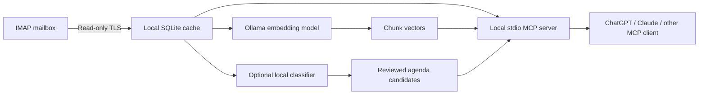

# OU Email Agent

Local IMAP email search, optional AI importance alerts, and an MCP server for desktop assistants. Originally built for an Osaka University mailbox; the host, account, folders and models are configurable. This is an independent community project, not an official university service.

**Windows-first prototype.** Works with password-based IMAP over verified TLS and local Ollama. OAuth-only accounts, macOS/Linux credential setup, attachment-content extraction, and remote HTTP MCP hosting are not implemented. AI classification is experimental and needs source review.

## What it does

- Imports mail without marking it read, moving, deleting, or sending messages.
- Searches with keywords, semantic similarity, and sender, recipient (To/Cc), and date filters.
- Links each text chunk to its email metadata and original thread headers.
- Optionally flags direct requests, deadlines, and meeting changes using a local model.
- Exposes eight MCP tools, including background indexing and an agenda review queue. Calendar/Obsidian writes and scheduling belong to your chosen assistant and its separate integrations.

The default monitor **only downloads mail**. Background classification and automatic embedding are disabled, avoiding a continuous GPU backlog. Search can run without the large classification model: keyword search needs no local model, and semantic search needs only the small embedding model.

## Architecture



## Install on Windows

Install Windows Python 3.11+ and [Ollama](https://ollama.com/). Clone this repository, then open PowerShell in the clone:

```powershell
Copy-Item config.example.json config.json
notepad config.json
powershell -NoProfile -ExecutionPolicy Bypass -File .\install.ps1
```

Set your IMAP `host`, `port` (usually 993), `username`, `folders`, and `timezone`. **Never put a password in config.json.** The installer creates a project virtual environment and installs dependencies. Its execution-policy flag applies only to that process.

For semantic search, download the embedding model:

```powershell
ollama pull embeddinggemma
```

Only if you want local importance classification/agenda extraction, also download your chosen classifier, for example `ollama pull qwen3:14b`. `install.ps1 -PullModels` downloads both configured models. Keep Ollama running.

1. Open `setup.cmd`. Enter your password privately. The verified password is saved in Windows Credential Manager, and a recent batch is imported.
2. Open `start-monitor.cmd`. The default sync-only monitor polls every 60 seconds. Stop it with Ctrl+C. Automatic sign-in startup is optional; see below.
3. Build the search index manually or enable the twice-daily schedule below.
4. Register MCP in your desktop assistant; see [MCP setup](docs/mcp-clients.md).

This source checkout is the runtime installation: keep it in place. `config.json`, `data/`, `.venv/`, logs and local verification files are ignored by Git.

## Indexing and commands

Run `.venv\Scripts\python.exe -m ou_email_agent` followed by:

| Command | Purpose |
| --- | --- |
| `status` | Counts, freshness, classification errors and embedding jobs |
| `doctor --login` | Verify TLS, saved login, folders and model availability |
| `sync` | Import one batch; stop the monitor first |
| `embed --limit 1 --max-requests 8` | Bounded CPU embedding, two threads by default; resumes saved chunks |
| `embed --retry-failed` | Explicit retry of a failed embedding job |
| `analyze --limit 1` | Manual classification and embedding; stop the monitor first |
| `retry-analysis` | Reset failed classification attempts; does not itself run inference |
| `search "purification" --sender "person@example.org" --after 2026-10-01` | Topic search with metadata filters |
| `monitor` | Sync-only by default; optional paced classification |
| `mcp` | Serve tools over stdio |

For on-demand indexing, open `index-cached-gpu.cmd` or ask your MCP assistant to call `start_email_indexing`. Both launch the same background worker and return immediately. Closing the launcher window does not stop that worker. Check `email_status` for its progress, remaining messages and errors. It uses only the small embedding model, with GPU offload by default, saves successful chunks, and unloads on exit (30-second idle expiry as fallback). It does not enable classification or change the CPU settings used by normal semantic searches.

Embedding chunks start at 1,800 UTF-8 bytes, with overlap. Rejected oversized chunks are split again without truncation. Completed chunks are reused. Semantic coverage is reported until all cached mail is embedded; keyword search already covers all cached bodies. Future imported messages require another indexing run.

For paced new-mail alerts, set `background_analysis` to `true` and restart the monitor. It classifies at most one new, non-historical message every 300 seconds by default, with one automatic attempt and no embedding work. These settings reduce average activity, not peak GPU power. Initial imported history is manual-only and does not trigger desktop alerts.

## Automatic startup and scheduled indexing

Set these optional fields in your private `config.json`:

```json
"indexing_times": ["09:00", "16:00"],
"scheduled_embedding_num_gpu": 99,
"indexing_max_seconds": 1200
```

Times use the **Windows local timezone**, independently of the email/classifier `timezone` setting. Use `0` instead of `99` for CPU indexing. The example config leaves the schedule disabled (`[]`). After saving, restart an existing monitor, or start it for the first time. To start it automatically at future Windows sign-ins, run:

```powershell
powershell -NoProfile -ExecutionPolicy Bypass -File .\enable-startup.ps1
```

This installs a shortcut in your own Startup folder, without storing a password there. It starts a hidden monitor under your Windows account, using the saved Credential Manager password. The installer does not launch an additional monitor now. Keep Ollama enabled at sign-in too. Logs rotate in `data/monitor.log`; `email_status` exposes sync freshness, indexing coverage, progress and errors. Run `disable-startup.ps1` to remove future automatic startup; it does not terminate an existing process. To stop a hidden monitor now, end its Python process in Task Manager. The monitor lock prevents a second monitor from running.

If Ollama runs inside WSL instead of Windows, set `ollama_wsl_distro` to its installed distribution name (for example `Ubuntu`). Its `ollama.service` must already be enabled in that distribution. The monitor starts WSL and keeps it available while monitoring, using a pipe that closes when the monitor exits; it does not install Ollama or change the service. Leave this setting empty for native Windows Ollama.

The monitor fetches mail every polling interval. After a successful sync finds no further new messages, it checks the indexing schedule. A missed time while powered off or asleep is coalesced into one catch-up after sign-in/wake and successful sync. This does not wake the PC, run before sign-in, or fetch mail while offline. Startup may be delayed briefly by Windows. Missed days do not create a backlog of duplicate scheduled runs.

Scheduled, manual and MCP indexing share a lock and process only unfinished cached messages. Each run snapshots the current queue, works in four-request batches with a one-second pause, and stops when done or after the 20-minute budget (checked between batches). Interrupted or partial work resumes next time. New arrivals after the snapshot wait for the next run. Successful chunks are never rebuilt just because another run was requested.

The scheduler makes at most three launch attempts per time slot, at least 15 minutes apart, so Ollama can finish starting after sign-in. Individual failed email embedding jobs remain visible and require an explicit repair with `embed --message ID --retry-failed`; they are not retried continuously. A completed worker can still leave previously failed messages uncovered: always check `index_coverage.failed` and `unfinished`. Automatic importance classification remains a separate opt-in setting.

## Models and hardware

### Synthetic pilot results

A [reproducible benchmark](benchmarks/results/2026-10-14-rtx5080/README.md) compares 48 synthetic English/Japanese messages on an RTX 5080 Laptop GPU. With the unchanged production prompt, thinking disabled and an 8,192-token context:

| Classifier | Correct and validated | Important messages retained | Median warm latency | Loaded model VRAM |
| --- | ---: | ---: | ---: | ---: |
| Qwen3 1.7B | 9/48 (18.8%) | 3/24 | 0.96 s | 2.08 GiB |
| Qwen3 4B | 44/48 (91.7%) | 23/24 | 1.19 s | 3.61 GiB |
| Qwen3 14B | 37/48 (77.1%) | 14/24 | 2.36 s | 9.75 GiB |

4B is a useful candidate to trial on smaller hardware. 1.7B often produced evidence quotes rejected by the current validator; 14B made fewer false important decisions but missed more reference-positive requests. These are assistant-labelled synthetic scenarios, including paired translations and debatable policy choices—not independent real-mail accuracy estimates. CPU-only and other-GPU performance were not measured. See the full report for raw accuracy, false positives, failures, per-case outputs, and limitations; [run the benchmark](benchmarks/README.md) on your own hardware before choosing.

Two independent models serve different purposes:

| Setting | Default | Used for |
| --- | --- | --- |
| `model` | `qwen3:14b` | Importance classification, summaries, agenda proposals |
| `embedding_model` | `embeddinggemma` | Semantic indexing and query vectors |

A smaller classifier such as `qwen3:4b` reduced memory and latency in this pilot. Any classifier may miss subtle requests, misread quoted/cancelled events, or produce unreliable evidence and dates. Test representative English/Japanese messages before using it for alerts; the synthetic benchmark does not establish real-mail accuracy. Existing classifications are preserved when you change the model; new analysis uses the new model. Changing only the classifier does not require rebuilding the semantic index. Changing the embedding model does.

See [model tradeoffs](docs/models.md). Neither a GPU nor the 14B model is required for keyword search. CPU embeddings are supported; their speed depends on hardware. A quantized model's download size is not its total runtime memory requirement. The default remains 14B; the pilot does not silently change existing installations.

## Privacy and reliability

Mail and vectors stay in a local SQLite database, which is **not application-encrypted**. The password is in Windows Credential Manager. Ollama requests are restricted to loopback and bypass configured HTTP proxies. No SMTP or mailbox mutation tools exist.

**When an assistant calls an MCP tool, the returned email excerpts enter that assistant's context.** Using local models does not make a cloud-connected ChatGPT/Claude session fully local. Each colleague installs their own cache and credentials; this repository contains no mailbox data or live configuration.

- Initial scope: last 30 days, INBOX. Sent/Archive folders require configuration; changing the initial-days setting does not backfill an existing checkpoint. Server moves/deletions are not mirrored.
- Attachments: names only. No attachment body or ICS parsing. Messages over 20 MB stop that folder until configured otherwise.
- Sender/recipient filters match header substrings; names may be ambiguous. To and Cc are combined. Bcc and SMTP envelope recipients are unavailable.
- Classification sees at most 16,000 body characters and reports truncation. Unsupported agenda details become source-review items. Invalid importance evidence is rejected. This is not a guarantee of correct extraction or complete alerts.
- Thread linking uses Message-ID, References and In-Reply-To. Search results should be verified against the full source/thread.
- Agenda completion is tracked per destination, but the assistant must prevent duplicate external writes using the `ou-email:<item_id>` marker. Use one scheduled agenda consumer; multiple readers are fine.
- Local stdio tools require a running local host. A cloud scheduler cannot be assumed to reach them. Validate your assistant's scheduling support separately.

## Testing

```powershell
.venv\Scripts\python.exe -m unittest discover -s tests -v
.venv\Scripts\python.exe -m tests.smoke_mcp
```

Tests use synthetic mail and mocked models: no real password, mailbox, model download, or GPU is needed. They cover IMAP read-only behavior, retries/checkpoints, search filters, evidence validation, agenda acknowledgement, bounded/resumable embeddings, and MCP tool discovery/calls.

`tests/smoke_models.py` is an optional small model smoke test using synthetic messages and the model settings in `config.example.json`. It is not a benchmark of real-mail accuracy. ChatGPT desktop integration has been exercised; Claude configuration is provided based on the MCP protocol and official host documentation, but has not been tested in Claude Desktop here.

## License

MIT. Model weights and dependencies retain their own licenses. See [LICENSE](LICENSE).
