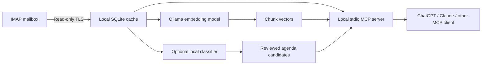

# OU Email Agent

Local IMAP email search, optional AI importance alerts, and an MCP server for desktop assistants. Originally built for an Osaka University mailbox; the host, account, folders and models are configurable. This is an independent community project, not an official university service.

**Windows-first prototype.** Works with password-based IMAP over verified TLS and local Ollama. OAuth-only accounts, macOS/Linux credential setup, attachment-content extraction, and remote HTTP MCP hosting are not implemented. AI classification is experimental and needs source review.

## What it does

- Imports mail without marking it read, moving, deleting, or sending messages.
- Searches with keywords, semantic similarity, and sender, recipient (To/Cc), and date filters.
- Links each text chunk to its email metadata and original thread headers.
- Optionally flags direct requests, deadlines, and meeting changes using a local model.
- Exposes seven MCP tools, including an agenda review queue. Calendar/Obsidian writes and scheduling belong to your chosen assistant and its separate integrations.

The default monitor **only downloads mail**. Background classification and automatic embedding are disabled, avoiding a continuous GPU backlog. Search can run without the large classification model: keyword search needs no local model, and semantic search needs only the small embedding model.

## Architecture



## Install on Windows

Install Windows Python 3.11+ and [Ollama](https://ollama.com/). Clone this repository, then open PowerShell in the clone:

```powershell
Copy-Item config.example.json config.json
notepad config.json
powershell -NoProfile -ExecutionPolicy Bypass -File .\install.ps1
```

Set your IMAP `host`, `port` (usually 993), `username`, `folders`, and `timezone`. **Never put a password in config.json.** The installer creates a project virtual environment and installs dependencies. Its execution-policy flag applies only to that process.

For semantic search, download the embedding model:

```powershell
ollama pull embeddinggemma
```

Only if you want local importance classification/agenda extraction, also download your chosen classifier, for example `ollama pull qwen3:14b`. `install.ps1 -PullModels` downloads both configured models. Keep Ollama running.

1. Open `setup.cmd`. Enter your password privately. The verified password is saved in Windows Credential Manager, and a recent batch is imported.
2. Open `start-monitor.cmd`. The default sync-only monitor polls every 60 seconds. Stop it with Ctrl+C. It does not start automatically at login.
3. Build the search index manually with one of the options below.
4. Register MCP in your desktop assistant; see [MCP setup](docs/mcp-clients.md).

This source checkout is the runtime installation: keep it in place. `config.json`, `data/`, `.venv/`, logs and local verification files are ignored by Git.

## Indexing and commands

Run `.venv\Scripts\python.exe -m ou_email_agent` followed by:

| Command | Purpose |
| --- | --- |
| `status` | Counts, freshness, classification errors and embedding jobs |
| `doctor --login` | Verify TLS, saved login, folders and model availability |
| `sync` | Import one batch; stop the monitor first |
| `embed --limit 1 --max-requests 8` | Bounded CPU embedding, two threads by default; resumes saved chunks |
| `embed --retry-failed` | Explicit retry of a failed embedding job |
| `analyze --limit 1` | Manual classification and embedding; stop the monitor first |
| `retry-analysis` | Reset failed classification attempts; does not itself run inference |
| `search "purification" --sender "person@example.org" --after 2026-10-01` | Topic search with metadata filters |
| `monitor` | Sync-only by default; optional paced classification |
| `mcp` | Serve tools over stdio |

For a one-time **GPU** index build, open `index-cached-gpu.cmd`. It runs only the small embedding model, saves chunk progress, stops after its initial cached-message snapshot is complete, and unloads the model on exit (30-second idle expiry as fallback). It stops on errors and can be interrupted with Ctrl+C. Progress is in `data/indexing-progress.json`. It does not change the CPU defaults or enable classification.

Embedding chunks start at 1,800 UTF-8 bytes, with overlap. Rejected oversized chunks are split again without truncation. Completed chunks are reused. Semantic coverage is reported until all cached mail is embedded; keyword search already covers all cached bodies. Future imported messages require another indexing run.

For paced new-mail alerts, set `background_analysis` to `true` and restart the monitor. It classifies at most one new, non-historical message every 300 seconds by default, with one automatic attempt and no embedding work. These settings reduce average activity, not peak GPU power. Initial imported history is manual-only and does not trigger desktop alerts.

## Models and hardware

Two independent models serve different purposes:

| Setting | Default | Used for |
| --- | --- | --- |
| `model` | `qwen3:14b` | Importance classification, summaries, agenda proposals |
| `embedding_model` | `embeddinggemma` | Semantic indexing and query vectors |

A smaller classifier such as `qwen3:4b` can reduce memory and often latency. It may miss subtle requests, misread quoted/cancelled events, or produce less reliable evidence and dates. These are expected risks, not a measured accuracy comparison for this project. Test representative English/Japanese messages before using it for alerts. Existing classifications are preserved when you change the model; new analysis uses the new model. Changing only the classifier does not require rebuilding the semantic index. Changing the embedding model does.

See [model tradeoffs](docs/models.md). Neither a GPU nor the 14B model is required for keyword search. CPU embeddings are supported; their speed depends on hardware. A quantized model's download size is not its total runtime memory requirement.

## Privacy and reliability

Mail and vectors stay in a local SQLite database, which is **not application-encrypted**. The password is in Windows Credential Manager. Ollama requests are restricted to loopback and bypass configured HTTP proxies. No SMTP or mailbox mutation tools exist.

**When an assistant calls an MCP tool, the returned email excerpts enter that assistant's context.** Using local models does not make a cloud-connected ChatGPT/Claude session fully local. Each colleague installs their own cache and credentials; this repository contains no mailbox data or live configuration.

- Initial scope: last 30 days, INBOX. Sent/Archive folders require configuration; changing the initial-days setting does not backfill an existing checkpoint. Server moves/deletions are not mirrored.
- Attachments: names only. No attachment body or ICS parsing. Messages over 20 MB stop that folder until configured otherwise.
- Sender/recipient filters match header substrings; names may be ambiguous. To and Cc are combined. Bcc and SMTP envelope recipients are unavailable.
- Classification sees at most 16,000 body characters and reports truncation. Unsupported agenda details become source-review items. Invalid importance evidence is rejected. This is not a guarantee of correct extraction or complete alerts.
- Thread linking uses Message-ID, References and In-Reply-To. Search results should be verified against the full source/thread.
- Agenda completion is tracked per destination, but the assistant must prevent duplicate external writes using the `ou-email:<item_id>` marker. Use one scheduled agenda consumer; multiple readers are fine.
- Local stdio tools require a running local host. A cloud scheduler cannot be assumed to reach them. Validate your assistant's scheduling support separately.

## Testing

```powershell
.venv\Scripts\python.exe -m unittest discover -s tests -v
.venv\Scripts\python.exe -m tests.smoke_mcp
```

Tests use synthetic mail and mocked models: no real password, mailbox, model download, or GPU is needed. They cover IMAP read-only behavior, retries/checkpoints, search filters, evidence validation, agenda acknowledgement, bounded/resumable embeddings, and MCP tool discovery/calls.

`tests/smoke_models.py` is an optional small model smoke test using synthetic messages and the model settings in `config.example.json`. It is not a benchmark of real-mail accuracy. ChatGPT desktop integration has been exercised; Claude configuration is provided based on the MCP protocol and official host documentation, but has not been tested in Claude Desktop here.

## License

MIT. Model weights and dependencies retain their own licenses. See [LICENSE](LICENSE).
