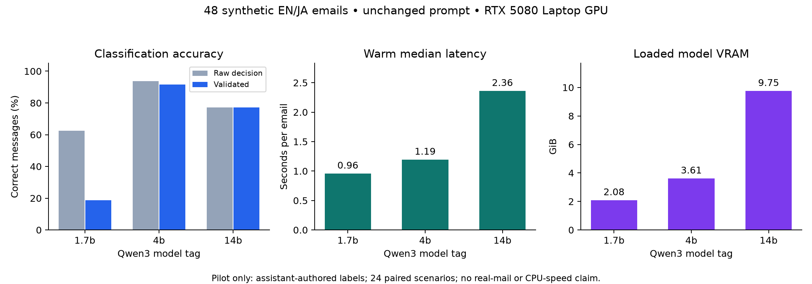

# Synthetic classification pilot: Qwen3 model sizes

48 synthetic messages: 24 scenarios in English and Japanese, with 24 important and 24 nonimportant messages. Assistant-authored labels; not independently human-labelled. This is a diagnostic pilot, not a measured accuracy claim for real university mail.

Hardware: NVIDIA GeForce RTX 5080 Laptop GPU, 16303 MiB VRAM. Ollama 0.32.14; 8192-token context; thinking off; temperature 0; seed 42. All models are Q4_K_M and were run sequentially with full GPU offload.

| Model | Validated accuracy | Raw importance accuracy | Failed outputs | Important recall | False important decisions | Median / p95 warm latency | Loaded model VRAM |
| --- | ---: | ---: | ---: | ---: | ---: | ---: | ---: |
| qwen3:1.7b | 18.8% | 62.5% | 33/48 | 12.5% | 6/24 | 0.96 / 1.14 s | 2.08 GiB |
| qwen3:4b | 91.7% | 93.8% | 1/48 | 95.8% | 3/24 | 1.19 / 1.85 s | 3.61 GiB |
| qwen3:14b | 77.1% | 77.1% | 0/48 | 58.3% | 1/24 | 2.36 / 4.28 s | 9.75 GiB |

Validated accuracy counts every failed/rejected output as incorrect. Importance recall counts rejected important messages as misses. False important decisions above are before the desktop notification category filter.

| Model | English validated accuracy | Japanese validated accuracy | Importance precision | Desktop notification recall | Desktop false alerts | Cold warm-up |
| --- | ---: | ---: | ---: | ---: | ---: | ---: |
| qwen3:1.7b | 16.7% | 20.8% | 33.3% | 12.5% | 2/24 | 16.75 s |
| qwen3:4b | 91.7% | 91.7% | 88.5% | 95.8% | 3/24 | 8.82 s |
| qwen3:14b | 79.2% | 75.0% | 93.3% | 58.3% | 1/24 | 12.27 s |

Desktop metrics assume new mail and the three default alert categories, with no priority sender overrides. This benchmark does not deliver notifications or modify the mailbox.

## Error details

### qwen3:1.7b

Rejected/error cases: long_thread-ja, mandatory_broadcast-en, availability_request-ja, room_change-ja, already_done-en, polite_request-en, explicit_deadline-ja, obsolete_quote-ja, reschedule-en, optional_seminar-en, mandatory_broadcast-ja, other_person-ja, attachment_request-en, already_done-ja, negated_request-en, availability_request-en, long_thread-en, attachment_request-ja, deadline_extension-en, polite_request-ja, other_meeting-en, out_of_office-ja, explicit_deadline-en, optional_seminar-ja, negated_request-ja, reschedule-ja, obsolete_quote-en, cancellation-en, room_change-en, new_over_quote-ja, direct_reply-ja, cancellation-ja, optional_call-en.

Accepted but incorrect importance decisions: receipt-ja, other_meeting-ja, receipt-en, rhetorical_question-en, other_person-en, out_of_office-en.

Exploratory 95% scenario-cluster bootstrap interval for validated accuracy: 6.2%–31.2%.

### qwen3:4b

Rejected/error cases: cancellation-en.

Accepted but incorrect importance decisions: other_person-ja, negated_request-en, negated_request-ja.

Exploratory 95% scenario-cluster bootstrap interval for validated accuracy: 81.2%–100.0%.

### qwen3:14b

Rejected/error cases: none.

Accepted but incorrect importance decisions: polite_request-en, mandatory_broadcast-ja, availability_request-en, long_thread-en, direct_reply-en, polite_request-ja, negated_request-ja, cancellation-en, new_over_quote-ja, direct_reply-ja, cancellation-ja.

Exploratory 95% scenario-cluster bootstrap interval for validated accuracy: 62.5%–89.6%.

## Interpretation limits

- Only 24 scenario designs; English/Japanese versions are paired. The exploratory interval does not describe real-mail performance.
- Each case was run once. These results do not quantify model variability across seeds or repeated runs.
- Many negative examples explicitly say no action is needed. Real messages can be substantially more ambiguous.
- Evidence validation measures exact source matching, not factual correctness of dates, summaries or event proposals. Calendar extraction was not scored.
- Latencies are warm GPU measurements on this RTX 5080 laptop. Smaller GPUs and CPU-only machines were not timed. Model VRAM allocation is not a universal minimum hardware requirement.
- Models use the current unchanged production prompt. A separately evaluated simpler prompt might improve smaller-model performance; these results do not prove a model is intrinsically incapable.
- Inspect per-case JSON outputs and run the same suite on your own hardware. Use independent human labels on representative private mail before trusting automated alerts.

See [methodology](../../README.md), [dataset](../../synthetic-v1.json), and [runner](../../run.py).
